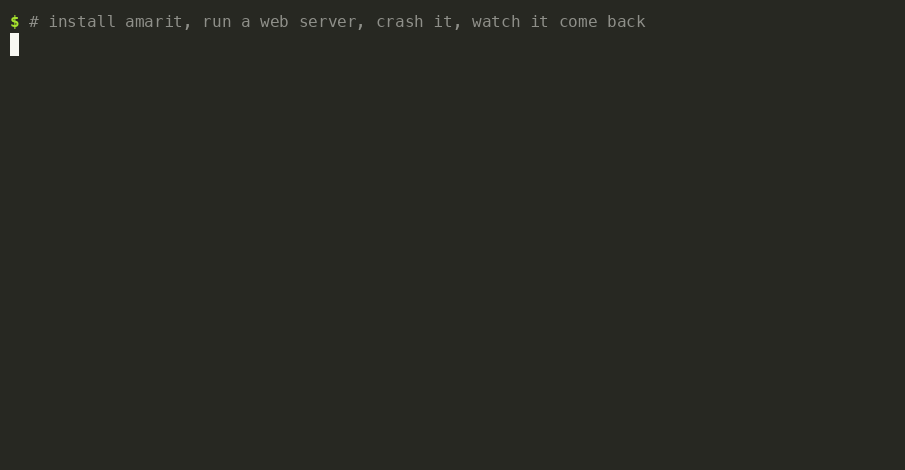

# amarit

[](https://github.com/sudiptadeb/amarit/actions/workflows/ci.yml)
[](https://pkg.go.dev/github.com/sudiptadeb/amarit)
[](LICENSE)

**Keep it alive. Keep it current.**

- **For anyone:** `amarit run <command>` keeps the command running. It is
  restarted when it crashes and started again after a reboot, and its logs
  are kept.
- **For developers:** add one line to a Go program and every installed copy
  can update itself, with a checksum check and an automatic rollback.

One small binary for macOS and Linux. It needs no config, never runs as root
and opens no ports. *Amar*: undying.



## Quick start

**1. Install**

```sh
curl -fsSL https://raw.githubusercontent.com/sudiptadeb/amarit/main/install.sh | sh
```

**2. Choose how amarit starts.** Do this once per machine.

| You want | Run | What you get |
|---|---|---|
| Programs that come back after a restart, even with nobody logged in. For servers, home labs and anything that must always be up | `sudo "$(command -v amarit)" install --system` | Starts at boot. This is the only time you need sudo |
| Programs that keep running after you close the terminal or log out of SSH. For quick jobs, tunnels and dev servers | nothing: just use `amarit run` | amarit starts in the background by itself. A reboot stops it, and the next `amarit run` brings it and your programs back |

Not sure? Start with `amarit run`. You can add the system install later,
and your programs and their settings stay as they are.

**3. Run something and check on it**

```sh
amarit run -name site python3 -m http.server 8080
amarit ls
amarit logs -f site
```

`site` now restarts whenever it exits. With the system install, it also
comes back after a reboot.

## Quick start for developers

Ship a Go program that updates itself. Each copy checks your release
manifest, verifies the new binary, swaps it in place and rolls back if the
new version does not come up.

**1. Describe your releases** in `amarit.json` at the root of the repository:

```json
{
  "project": "hello",
  "releases": "https://github.com/you/hello/releases/latest/download/releases.json",
  "release": {
    "targets": ["darwin/arm64", "linux/amd64"],
    "asset": "hello-{os}-{arch}-v{version}",
    "url": "https://github.com/you/hello/releases/download/v{version}/{asset}"
  }
}
```

**2. Add one line** to `main` (after `go get github.com/sudiptadeb/amarit`):

```go
import "github.com/sudiptadeb/amarit"

func main() {
    amarit.Start()
    // your program as before
}
```

**3. Build and publish a release:**

```sh
for t in darwin/arm64 linux/amd64; do
  GOOS=${t%/*} GOARCH=${t#*/} go build -ldflags "$(amarit stamp -version 1.1.0)" \
    -o dist/hello-${t%/*}-${t#*/}-v1.1.0 .
done
amarit release -version 1.1.0 -dist dist -out dist/releases.json
gh release create v1.1.0 dist/*
```

**4. Updates reach users.** They run `hello update`, or `hello --auto-update`
to check every hour. For programs running under amarit, `amarit update`
updates them all.


Updates are opt-in. Nothing updates until the user passes `--auto-update`,
the program runs under amarit, or the project makes auto-update its
default. [Self-updating programs](#self-updating-programs) below has more.

---

## Everyday commands

| Command | What it does |
|---|---|
| `amarit run [-name N] <cmd> [args...]` | keep a command running (also `-instances N`, `-restart on-failure`, `-dir D`, `-env-file F`) |
| `amarit ls` | list every program with its state, pid and restart count |
| `amarit logs [-f] <name>` | show its output; `-f` follows |
| `amarit restart <name\|glob> [-rolling]` | restart now; `-rolling` does one copy at a time |
| `amarit stop <name>` / `amarit start <name>` | take it down and keep it down, or bring it back |
| `amarit rm <name>` | stop managing it |
| `amarit update [-check]` | move programs built with amarit onto their latest release |
| `amarit uninstall` | remove the daemon; your programs keep running |

Names take a single copy (`worker@2`) or a glob (`'web-*'`).

```sh
amarit run -name worker -instances 4 ./worker          # four copies: worker@1 .. worker@4
amarit run -name tunnel ssh -N -R 7900:127.0.0.1:7900 vps
amarit restart 'worker@*' -rolling                     # each must stay up 2 s before the next
```

## What you get

- **Restarts on exit.** It backs off from 1 s to 1 min when a program keeps
  failing, and you can choose `always`, `on-failure` or `never`.
- **Survives reboots.** launchd or systemd starts amarit, and amarit starts
  your programs.
- **Logs.** Each program writes to `~/.amarit/logs/<name>.log`, rotated
  at 10 MB.
- **Several copies.** `-instances 4` runs `worker@1` to `worker@4`. Restart
  them one at a time with `-rolling`.
- **Runs as you.** Root is used once, to register amarit with the system.
  The daemon and your programs never run as root.
- **No double supervision.** amarit refuses to run a program that launchd
  or systemd already manages, and tells you how to remove the other one.
- **Stays current.** The daemon updates itself from amarit's releases and
  rolls back if a new version does not start.

## Configure a program

Each program is a JSON file in `~/.amarit/units/`. `amarit run` writes it
for you. Edit it to change anything, and the daemon picks the change up
within seconds (`amarit restart <name>` applies it to a program that is
already running):

```json
{
  "name": "worker",
  "binary": "/usr/local/bin/worker",
  "args": ["-id", "{instance}"],
  "env_file": "/etc/worker.env",
  "dir": "/var/lib/worker",
  "instances": 4,
  "restart": "on-failure",
  "stop_timeout": "60s",
  "limits": {"nofile": 65536}
}
```

Put secrets in `env_file`, which is read at start and never copied. Every
field is described in [docs/daemon.md](docs/daemon.md#units).

## Where it runs

| You ran | macOS | Linux | Survives a reboot with nobody logged in |
|---|---|---|---|
| `sudo amarit install --system` | LaunchDaemon | systemd system service | yes |
| `amarit install` (no sudo) | LaunchAgent | systemd user service plus linger | Linux: yes, when linger can be enabled. macOS: no, it starts at login |
| neither, just `amarit run` | detached daemon | detached daemon | no: it survives closing the terminal, not a reboot |

In every case the daemon and your programs run as you. The CLI talks to the
daemon only through files in `~/.amarit`: there is no socket and no port.
The full trust model, including what is written where and who owns each
file, is in [docs/daemon.md](docs/daemon.md#who-runs-as-whom).

## Self-updating programs

What the developer quick start sets up, in more depth:

- **Safe swaps.** Every check before the swap fails closed. The previous
  binary is kept until the new one reports healthy, and a version that
  fails three starts is rolled back without anyone logging in.
- **Same PID.** The program restarts in place, so launchd, systemd and
  nohup do not notice. Listeners and terminals can be handed across with
  `amarit.Handoff`.
- **Channels and rollouts.** The manifest supports `stable` and `canary`
  channels, staged rollouts, and a `min_version` floor that also works as a
  kill switch.
- **No release host needed.** For services built on the machine they run
  on, point `releases` at a local directory.
- **Android too.** A Kotlin library reads the same manifest and hands the
  APK to the package installer.

The full guide is [docs/updates.md](docs/updates.md), the manifest format
is [docs/spec.md](docs/spec.md), and the reasoning behind the design is
[docs/design.md](docs/design.md).

## Install options

The script detects macOS or Linux on amd64 or arm64, downloads the binary
from the latest [release](https://github.com/sudiptadeb/amarit/releases),
checks it against `SHA256SUMS`, and installs it to `/usr/local/bin`, or
`~/.local/bin` when that is not writable.

```sh
curl -fsSL https://raw.githubusercontent.com/sudiptadeb/amarit/main/install.sh | AMARIT_VERSION=v0.6.0 sh       # a specific release
curl -fsSL https://raw.githubusercontent.com/sudiptadeb/amarit/main/install.sh | AMARIT_INSTALL_DIR=~/bin sh     # a specific directory
go install github.com/sudiptadeb/amarit/cmd/amarit@latest                                                        # from source, into ~/go/bin
```

To remove it, stop your programs (`amarit stop <name>`), run `amarit
uninstall` (`sudo amarit uninstall` for a macOS `--system` install; on
Linux, `sudo systemctl disable --now amarit-$USER` and delete its unit
file), then delete the binary and `~/.amarit`.

## Status

Early. The daemon, hash-verified updates, descriptor
handoff and the Android library work end to end. Next on the roadmap:
overlap restarts, signed and enterprise tiers, unit health probes, adopting
existing services, Windows, and spec 1.0.

MIT. See [LICENSE](LICENSE).
